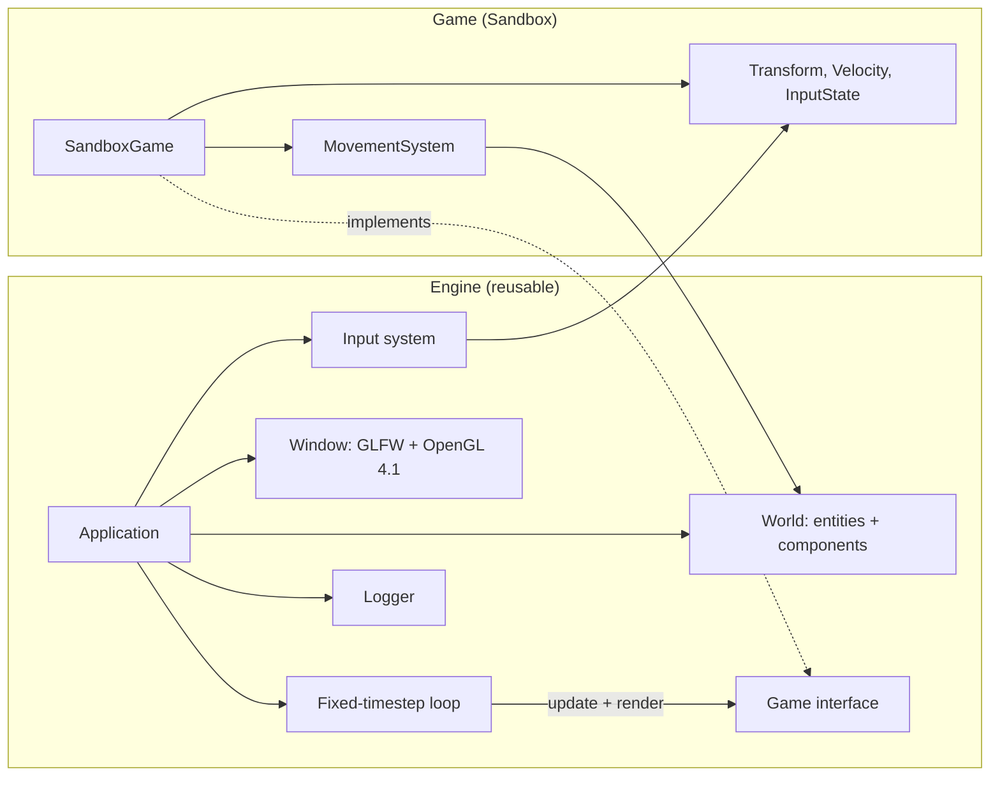

<h3 align="center">Game Developer • Software Engineer • Full-Stack Developer</h3>

<p align="center">
  
</p>

<p align="center">
  <a href="https://portfolioemma.vercel.app/"></a>
  <a href="https://www.linkedin.com/in/emma-maikuri-997ba631"></a>
  <a href="mailto:maikuriemma@gmail.com"></a>
</p>

---

## 👩‍💻 About

I build the systems behind interactive products: **C++ game engine foundations**, **full-stack web applications** and **AI-assisted automation**.

- 🎮 Building a game engine from scratch in **C++20**, with a focus on clean architecture
- 🌐 Three years of professional software development, plus freelance work since 2016
- 🏭 Previously Software Developer & IT Lead at **Plumbee Wholefoods**: built websites and data systems, automated recruitment, onboarding and reporting, and set up the company's IT function
- 🚀 I design, build and sell my own products, from idea to payments to support
- ⚽ Amateur footballer who loves teamwork on and off the field

📬 **Open to part-time opportunities in game development and software engineering.**

---

## 🎮 Featured Project: C++ Game Engine

<p>
  
  
  
  
  
  
</p>

A game engine written from scratch, with no off-the-shelf engine underneath, to learn how games actually work: timing, input, simulation and the architecture that keeps them maintainable. The goal is a clean separation between **the engine** (reusable) and **the game** (built on top of it).

<!-- Add a short GIF of the Sandbox running here for maximum impact:
<p align="center"></p> -->

### Architecture



### What's built

- ⏱️ **Fixed-timestep game loop** with an accumulator and interpolation, so the simulation is deterministic and rendering stays smooth at any frame rate
- 🧩 **Entity-component `World`**: a registry that stores components per entity, with game code looking them up through the world instead of owning them directly
- 🎹 **Input layer** that separates physical keys from game *intent*, with proper held vs pressed handling, on real GLFW keyboard input
- 🪟 **Native window** on an OpenGL 4.1 core context, running on Apple Silicon
- 🧱 **Strict dependency rule:** the engine never depends on the game, only the other way round

### Design decisions

| Decision | Why |
|---|---|
| Fixed timestep with interpolation | Physics and gameplay behave identically on slow and fast machines |
| Components in a `World` registry, not inside entities | Keeps data and behaviour separate, and prepares the ground for multi-entity ECS |
| Input as intent (`moveLeft`) instead of raw keys (`A`) | Lets controls be rebound and keeps game code free of GLFW |
| Engine and game as separate targets | The engine can be reused by any game without changes |

### The loop at the heart of it

```cpp
const double dt = 1.0 / 60.0;          // fixed simulation step
double accumulator = 0.0;

while (running) {
    accumulator += frameTime();

    while (accumulator >= dt) {         // catch up in fixed steps
        game.update(dt);
        accumulator -= dt;
    }

    game.render(accumulator / dt);      // interpolate between states
}
```

### Roadmap

- [x] Engine skeleton, logger and application structure
- [x] Fixed-timestep loop with interpolation
- [x] Real keyboard input and engine/game boundary
- [x] World registry with components and systems
- [ ] Multi-entity ECS
- [ ] Rendering pipeline
- [ ] Physics integration
- [ ] Modern graphics API backend (Metal / MoltenVK)

---

## 🧱 Products & Projects

| Project | What it is | Built with |
|---|---|---|
| 🎮 **C++ Game Engine** | Engine from scratch (in progress) | C++20, CMake, GLFW, OpenGL |
| 📚 **PromptGuide** | Prompt library web app, sold on Gumroad | React, Vite |
| 📄 **ResumePro** | AI-powered CV analyser | React, Supabase, Paystack |
| 🚀 **LaunchKit** | SaaS starter for launching web products | Next.js |
| 🔁 **n8n Workflows** | Business automation workflows, published on Gumroad | n8n |

More projects: **[portfolioemma.vercel.app](https://portfolioemma.vercel.app/)**

---

## 🛠️ Tech Stack

**🎮 Game Development & Engineering**


C++20 • CMake • OpenGL • GLFW • Unreal Engine 5 • Game loops • Entity-component systems • Algorithms and data structures

**💻 Languages**


**🌐 Web & Backend**


**🗄️ Data & Cloud**


**🧰 Tools & Automation**


n8n • Airtable • REST APIs • Agile • Machine learning

---

## 📈 GitHub Stats

<p align="center">
  
  
</p>


